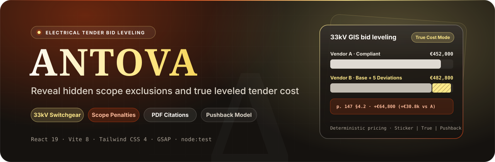
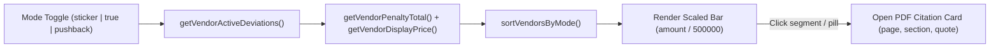

<p align="center">
  
</p>

<p align="center">
  
</p>

<p align="center">
  <a href="https://react.dev"></a>
  <a href="https://vite.dev"></a>
  <a href="https://tailwindcss.com"></a>
  <a href="https://www.typescriptlang.org"></a>
  <a href="https://bun.sh"></a>
</p>

**Antova** is an interactive web application showcasing technical bid leveling and commercial scope auditing for high- and medium-voltage electrical equipment tenders. Built as a static React 19, Vite 8, Tailwind CSS 4, and GSAP single-page application, it computes deterministic leveled prices across compliant and deviated switchgear bids with page-level specification citations.

---

## Contents

- [Features](#features)
- [Deterministic bid-leveling engine](#deterministic-bid-leveling-engine)
- [Application architecture](#application-architecture)
- [Getting started](#getting-started)
- [Environment variables](#environment-variables)
- [Testing](#testing)
- [Scripts](#scripts)
- [Repository notes and limitations](#repository-notes-and-limitations)

---

## Features

| Section | Implementation | Interactive behavior |
| :--- | :--- | :--- |
| **Interactive hero comparator** | `HeroSection.tsx` | Switches the `33kV GIS SWITCHGEAR PACKAGE` chart (`MAX_AXIS_EUR = 500000`) between `sticker`, `true`, and `pushback` modes; clicking deviation segments opens an inline PDF citation popover (`page`, `name`, `penalty`, `quote`). |
| **Pinned workflow stack** | `ProblemStackSection.tsx` + `tilt-stack-scroll.tsx` | Uses GSAP + `ScrollTrigger` to pin three workflow stages (`01 / BID EVALUATION`, `02 / TECHNICAL AUDIT`, `03 / CONTRACT EXECUTION`) with index jump controls. |
| **Redline comparison & 3D audit card** | `SolutionMockupSection.tsx` | Interactive hover slider (`"As Quoted" €418,000` vs `"Audited" €482,800`) paired with a perspective `DepthCard3D` surfacing exclusion penalties (`+€4,000 (FAT Excluded)`). |
| **Capabilities bento** | `FeatureBentoSection.tsx` | Four capability cards covering Financial Auditing, Specification Checks, Cost Governance, and a cycling Pushback Notice feed (`2800ms` interval). |
| **Tiered pricing, FAQ & intake** | `OfferFormAndFaqSection.tsx` | Pre-selects tier (`Shadow Audit`, `Per Tender`, `Unlimited`) into the request banner, validates work email (`validateWorkEmail`), and uses Radix Accordion for FAQ items. |
| **Team view** | `TeamPage.tsx` (`Team01`) | Dedicated `/team` view managed via `window.history.pushState` / `popstate` transitions. |

---

## Deterministic bid-leveling engine

All chart totals and vendor ordering are calculated deterministically by `src/utils/audit.ts` against `VENDOR_BIDS` in `src/constants.ts`:

| Vendor | Mode | Base price | Active deviations | Total leveled cost | Delta vs Vendor A |
| :--- | :--- | :--- | :--- | :--- | :--- |
| **Vendor A** | `sticker` / `true` / `pushback` | `€452,000` | `0` | `€452,000` | `—` |
| **Vendor B** | `sticker` | `€418,000` | `0` shown | `€418,000` | `-€34,000` |
| **Vendor B** | `true` | `€418,000` | `5` deviations (`+€64,800`) | `€482,800` | `+€30,800` |
| **Vendor B** | `pushback` | `€418,000` | `2` remaining (`+€18,300`; `€46,500` absorbed) | `€436,300` | `-€15,700` |



---

## Application architecture

Despite `express` and `@google/genai` appearing in `package.json`, the application runs exclusively in the browser (`index.html` -> `src/main.tsx` -> `src/App.tsx`).

- **Client-side routing**: `src/App.tsx` tracks `PageView` (`'home' | 'team'`) with `window.history.pushState` and a `popstate` listener rather than React Router.
- **No live backend or Gemini calls**: `submitAuditRequest()` in `src/utils/audit.ts` logs the validated payload (`email`, `company`, `equipment`) via `console.log` and renders client-side confirmation copy without making network requests.

---

## Getting started

### Prerequisites

- Node.js 20+ or Bun (a `bun.lock` lockfile is committed; no `package-lock.json`)

### Install and run locally

```bash
# 1. Install dependencies
bun install
# or: npm install

# 2. Start Vite dev server on http://localhost:3000
bun run dev
# or: npm run dev
```

### Build for static hosting

```bash
bun run build
# Outputs static site bundle into dist/
```

---

## Environment variables

Only Vite HMR disabling is read from the environment in `vite.config.ts`. No backend secrets or `import.meta.env.*` client variables are consumed at runtime.

| Variable | Scope | Local development | Notes |
| :--- | :--- | :--- | :--- |
| `DISABLE_HMR` | Vite config | Optional (`"true"` disables HMR & file watching) | Read via `process.env.DISABLE_HMR` in `vite.config.ts` |
| `GEMINI_API_KEY` | `.env.example` | Documented in `.env.example`; unused in `src/` | Legacy Google AI Studio template variable |
| `APP_URL` | `.env.example` | Documented in `.env.example`; unused in `src/` | Legacy Google AI Studio template variable |

---

## Testing

Four unit tests in `src/utils/audit.test.ts` (using `node:test` and `node:assert/strict`) validate:
1. Exact penalty sums and leveled prices for Vendor A and Vendor B across `'sticker'`, `'true'`, and `'pushback'` modes.
2. Vendor sort flip between `'sticker'`/`'pushback'` and `'true'` modes.
3. Euro formatting (`formatEuro`) and work-email validation (`validateWorkEmail`).
4. Copy integrity across `src/constants.ts` (zero em-dashes and no leftover `'SpecClaw'` strings).

`package.json` does not currently define a `"test"` script; execute tests with TypeScript execution support (e.g., `npx tsx --test src/utils/audit.test.ts`).

---

## Scripts

| Command | Description |
| :--- | :--- |
| `npm run dev` | Starts Vite development server on port `3000` (`--host=0.0.0.0`) |
| `npm run build` | Builds the production static bundle into `dist/` |
| `npm run preview` | Previews the built `dist/` bundle locally |
| `npm run clean` | Removes `dist` and `server.js` via POSIX `rm -rf` |
| `npm run lint` | Runs `tsc --noEmit` |

---

## Repository notes and limitations

- **Static asset bloat in `public/assets/aistudio/`**: Vite copies all files inside `public/` into `dist/`. `public/assets/aistudio/` currently holds ~40 leftover template files (including `logo_c4fbe4bd.svg` / `favicon_eb2bad29.svg` for an unused `"Mainline"` template and `specclaw_92c0b988.zip` at ~68.2 MiB) that are not referenced by the app.
- **Unused dependencies**: `express`, `@types/express`, `@google/genai`, `dotenv`, `@number-flow/react`, and `@radix-ui/react-icons` are listed in `package.json` without any imports in `src/`. Both `framer-motion` and `motion` are installed and used in separate components.
- **SPA rewrite required for `/team`**: `window.history.pushState` navigates to `/team`, so static hosts must rewrite unknown routes to `index.html` to support direct refreshes on `/team`.
- **AI Studio `fetch` wrapper**: `index.html` includes an inline `<script>` overriding `window.fetch` property descriptors and suppressing uncaught `chrome-extension://` errors.
- **No backend intake persistence**: Submitting `#audit` runs `submitAuditRequest()` (`console.log` only) rather than transmitting an NDA or emailing upload links.

---

<p align="center">
  <sub>Antova · React 19 · Vite 8 · Tailwind CSS 4 · GSAP · Electrical Bid Leveling</sub>
</p>
