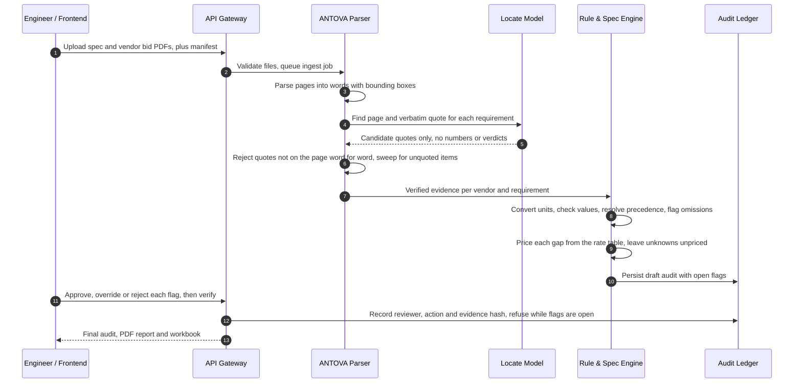

<p align="center">
  
</p>

# Antova

**The cheapest bid isn't the cheapest.** Antova reads every vendor bid against your technical specification, prices what each bid leaves out, and ties every flag to the page and exact words behind it.

Built for procurement and estimating teams comparing bids on heavy electrical equipment. Supported today: 33 kV gas-insulated switchgear.

## Overview and problem

An industrial equipment tender runs to hundreds of pages per bid. The lowest quote often wins because the missing items sit in one footnote: a lower short-circuit rating, aluminium busbars where copper was specified, factory testing "charged extra", freight left out. After award they come back as change orders.

Today a buyer's engineer finds these by hand, in a spreadsheet, under deadline. Antova automates the repetitive part and keeps the judgment with a person:

- **Reads** each bid for the sentence that answers each requirement, with its page and position.
- **Checks** the values in code. Units are converted (104 °F becomes 40 °C) before they meet the spec limit.
- **Prices** each gap from a versioned rate table. An unknown quantity is marked unpriced, never counted as zero.
- **Halts for approval.** A manager, engineer or analyst on the buyer's procurement team approves every flag before an audit is final. The award decision stays with the buyer.

On the benchmark 33 kV switchgear package, the lowest headline bid (€418,000) is ranked last once its gaps are priced (from €479,650, a lower bound because one gap cannot be priced from the documents).

## Tender Audit Architecture

Bid evaluations execute through deterministic rule engines and schema-validated parsing. No unverified model output is committed to a commercial table without deterministic cross-checks and a named reviewer's sign-off.

The model only finds quotes. It returns a page number and the verbatim words, nothing else. Every number, unit, pass/fail decision and euro amount is produced by code.



| Step | What happens | Code |
| :--- | :--- | :--- |
| 1 to 2 | PDFs are checked before they are kept: header, size, page count, encryption. | `antova_backend/antova_upload_api.py` |
| 3 to 7 | Pages become words with coordinates. The model proposes quotes. A quote that is not on its page word for word is dropped. A recall sweep catches value-shaped sentences the model missed. Scanned pages are flagged for manual review. | `antova_backend/antova_ingest/parse.py`, `extract.py`, `verify.py`, `sweep.py` |
| 8 | Values are read and compared with the spec. Drawings and bills of materials outrank cover letters. A contradiction keeps both pages. A missing item is marked omitted. | `values.py`, `precedence.py`, `ontology.py` |
| 9 | Each gap is priced from a versioned rate table. The strict warranty rule flags a warranty counted from a different start point and leaves it unpriced unless the spec states the gap. | `costs.py`, `rates/mv_gis_switchgear_v2.json` |
| 10 to 13 | A draft stays a draft while any flag is open. Approvals are recorded per cell with the reviewer's identity, and a changed re-ingest makes an old approval stale. | `antova_review.py`, `antova_review_api.py`, `antova_db.py` |

## Repository blueprint

```text
.
├── src/                          Marketing landing page (React 19, Vite, Tailwind 4)
│   ├── components/               Hero, narrative, pricing, FAQ, intake form
│   ├── constants.ts              All page copy; every figure comes from the benchmark package
│   ├── data/tender402.ts         Benchmark 33 kV package as the page renders it
│   └── utils/audit.test.ts       Copy and figure checks
├── public/                       Logo, banner, founder photo
├── antova_backend/           Audit engine (Python, FastAPI, SQLAlchemy)
│   ├── antova_api.py         App entry, job routes, health
│   ├── antova_upload_api.py  Tender PDF and manifest intake with checks
│   ├── antova_review_api.py  Flags, approvals, overrides, verify, exports
│   ├── antova_briefs_api.py  Shareable read-only audit briefs
│   ├── antova_auth.py        Named reviewer tokens
│   ├── antova_workers.py     Background ingest queue (single worker)
│   ├── antova_engine.py      Evaluated prices, ranking, negotiation what-ifs
│   ├── antova_db.py          Tenders, cells, reviews, overrides, ledger
│   ├── antova_export.py      Vendor clarification logs, verified workbook
│   ├── antova_ingest/        The ingestion pipeline
│   │   ├── parse.py extract.py   PDF to words, model quote lookup
│   │   ├── verify.py sweep.py    Quote verification, recall sweep
│   │   ├── values.py             Number, unit and clause parsing (pint)
│   │   ├── ontology.py           The eight evaluated parameters and their rules
│   │   ├── precedence.py         Evidence ranking, conflicts, warranty basis
│   │   ├── costs.py rates/       Rate-table versions and pricing
│   │   └── eval.py               Accuracy across generated edge-case packs
│   ├── samples/                  Reference tender datasets and their generator
│   ├── web/                      Review and brief app (React, TypeScript, Vitest, Playwright)
│   └── docs/                     Design notes, deploy checklist, roadmap
└── .github/workflows/ci.yml      Backend and web tests on every pull request
```

## Local setup

Requires Python 3.12+ and Node 20+.

**Landing page**

```bash
npm install
npm run dev          # http://localhost:3000
npm test
```

**Audit engine**

```bash
cd antova_backend
pip install -r antova_requirements.txt
python -m pytest -q
```

Run the full pipeline on the benchmark 33 kV switchgear package, offline, using recorded model answers, and compare it with the answer key:

```bash
python -m antova_ingest.run samples/TENDER-2026-402 --mode replay --verify
```

Serve the API. Use a single worker: the job queue is in-process.

```bash
ANTOVA_REVIEW_TOKEN=change-me uvicorn antova_api:app --port 8000
```

Live runs need a locate-model key (`ANTHROPIC_API_KEY` or `EXPLABS_API_KEY`). Copy `antova_backend/.env.example` to `antova_backend/.env`.

**Review app**

```bash
cd antova_backend/web
npm ci
npm run dev
```

## Status

- The pipeline passes 800+ backend tests and a web suite that pins the TypeScript pricing math to the Python engine. CI never calls a paid API.
- The reference tender datasets are synthetic: generated documents and fictional vendors, with a known answer key. The parser has not yet been run on customer tenders, and scanned pages are flagged, not read.
- Rate tables carry one rate per item. Rate ranges and currency conversion are not built.
- See [`antova_backend/docs/yc-demo-roadmap.md`](antova_backend/docs/yc-demo-roadmap.md) for what is next.

## License

See [LICENSE](LICENSE).
