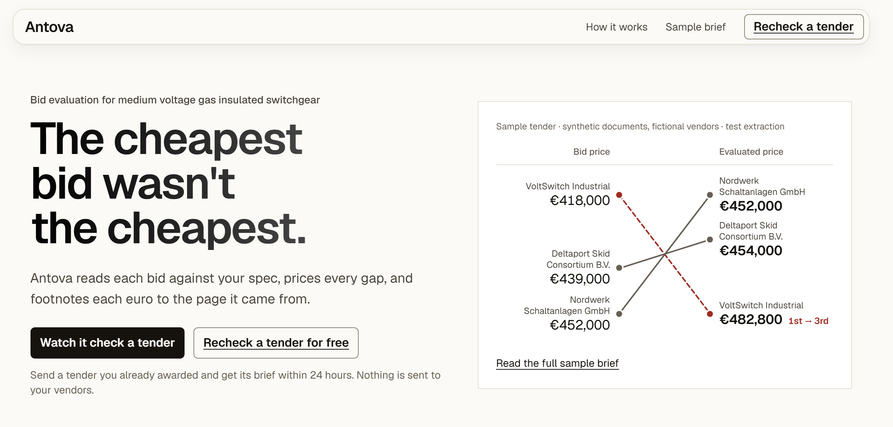

<div align="center">

# Antova

**The cheapest bid wasn't the cheapest.**

Bid evaluation for heavy electrical equipment tenders.<br />
Antova reads each bid against your spec, prices every gap,<br />
and footnotes each euro to the page it came from.

<br />



</div>

<br />

## How it works

**Read.** For each requirement in your spec, Antova finds the sentence in each bid that answers it, and keeps its page and position.

**Check.** Code compares the values, not the model. 104 °F becomes 40 °C before it meets your 40 °C limit. A quote that isn't on its page word for word is thrown out.

**Price.** Each gap is priced from a rate table you can read: 11 bays × €1,600 + €900 for type test documents.

> The model finds quotes. Code does the maths.

## The sample

The sample tender is synthetic: generated documents and fictional vendors. VoltSwitch Industrial bids €418,000, the lowest of three. Once its gaps are priced its evaluated price is €482,800, which ranks it last. Nordwerk Schaltanlagen wins at €452,000.

## Run it locally

The landing page renders from a committed sample, so it needs nothing else running.

```bash
cd web
npm install
npm run dev
```

Open <http://localhost:5173>. Run the tests with `npm test`.

## Built with

TypeScript, React, Vite, and a Python ingest pipeline. Set in Geist.
